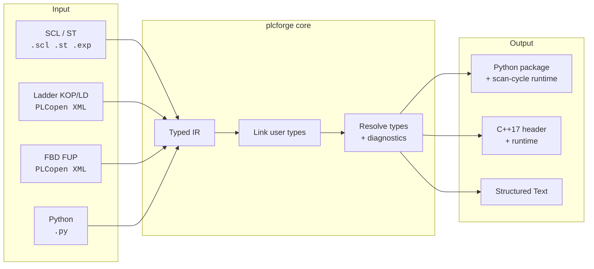

<div align="center">

# plcforge

**Translate IEC 61131-3 control programs into real Python or C++ projects — and back again.**

SCL · Structured Text · Ladder (KOP/LD) · Function Block Diagram (FUP/FBD) → Python · C++ → Structured Text

[](https://github.com/alex-hahn/plcforge/actions/workflows/ci.yml)
[](https://www.python.org/downloads/)
[](https://en.cppreference.com/w/cpp/17)
[](https://webstore.iec.ch/publication/4552)
[](LICENSE.md)
[](COMMERCIAL-LICENSE.md)
[](pyproject.toml)

</div>

---

## Why

PLC code is locked inside the engineering tool. You cannot unit test a ladder rung in CI,
you cannot diff a function block diagram in a pull request, and you cannot reuse a
proven control algorithm in a simulation, a digital twin or an edge service without
rewriting it by hand — and a hand rewrite is exactly where the behaviour quietly drifts.

plcforge translates the program instead. Point it at your SCL, Structured Text or
PLCopen XML export and it produces a Python package or a C++ header that behaves the
same way: the same scan cycle, the same `TON` timing, the same integer arithmetic.
Then it translates back, so the version that is easy to test is not a fork of the
version that runs the plant.

```bash
plcforge convert  Conveyor.scl --target python --out ./generated
plcforge convert  MotorStarter.xml --target st        # a ladder diagram, as readable ST
plcforge scaffold plant --from ./plc_src --out ./plant  # a complete, runnable repository
plcforge lift     controller.py --out Controller.st    # and the way back
```

---

## What makes the translation trustworthy

Anyone can map `IF` onto `if`. The value is in the places where the obvious mapping is
**wrong**, and where a hand rewrite silently changes the plant's behaviour:

| IEC 61131-3 says | The naive Python is | plcforge emits |
|---|---|---|
| `-7 / 2` is `-3` (truncates toward zero) | `-7 // 2` → `-4` ❌ | `idiv(-7, 2)` → `-3` ✅ |
| `-7 MOD 2` is `-1` (sign of the dividend) | `-7 % 2` → `1` ❌ | `imod(-7, 2)` → `-1` ✅ |
| `FOR i := 1 TO 4` runs four times | `range(1, 4)` → three ❌ | `iec_range(1, 4)` → four ✅ |
| `ARRAY [1..5]` is indexed from one | `list[0]` is the first ❌ | `Array([(1, 5)], …)` ✅ |
| `AND` is bitwise on `WORD`, logical on `BOOL` | always `and` ❌ | `&` or `and`, by declared type ✅ |
| `INT` rolls over at 32767 | grows forever ❌ | `--strict-integers` wraps ✅ |

Each of these is covered by a test that **runs the generated program** and asserts the
result — not by a golden file that only proves the text has not changed.

---

## How it works

One intermediate representation sits between every language, so adding a frontend costs
one reader and adding a target costs one writer. Nothing else has to change.



The type resolver is not decoration. It is what lets the backend decide between `and`
and `&`, between `/` and `idiv`, and it is what turns a wrong pin name on a timer into a
diagnostic instead of an `AttributeError` at three in the morning.

---

## A worked example

### In: Structured Text

```pascal
FUNCTION_BLOCK ConveyorSegment
VAR_INPUT
    enable : BOOL;                  (* master enable from the line control *)
    jam    : BOOL;
    setup  : ConveyorSetup;
END_VAR
VAR_OUTPUT
    speed  : REAL;
    state  : ConveyorState;
END_VAR
VAR
    rampTimer : TON;
END_VAR
    rampTimer(IN := enable AND NOT jam, PT := setup.rampTime);

    CASE state OF
        Idle:
            IF enable AND NOT jam THEN state := Starting; END_IF;
        Starting:
            IF rampTimer.Q THEN state := Running; END_IF;
    END_CASE;
END_FUNCTION_BLOCK
```

### Out: Python

```python
class ConveyorSegment(FunctionBlock):
    """One conveyor segment: start/stop with a ramp and jam supervision.

        in  enable : BOOL - master enable from the line control
        in  jam : BOOL
        in  setup : ConveyorSetup
       out  speed : REAL
       out  state : ConveyorState

    Translated from ST source.
    """

    def __init__(self, clock: Clock | None = None) -> None:
        super().__init__(clock)
        # VAR_INPUT
        self.enable: BOOL = False    # master enable from the line control
        self.jam: BOOL = False
        self.setup: ConveyorSetup = ConveyorSetup()
        # VAR_OUTPUT
        self.speed: REAL = 0.0
        self.state: ConveyorState = ConveyorState.Idle
        # VAR
        self.rampTimer: TON = TON(clock)

    def body(self) -> None:
        """The block logic, executed once per call."""
        self.rampTimer(IN=self.enable and not self.jam, PT=self.setup.rampTime)
        if self.state == ConveyorState.Idle:
            if self.enable and not self.jam:
                self.state = ConveyorState.Starting
        elif self.state == ConveyorState.Starting:
            if self.rampTimer.Q:
                self.state = ConveyorState.Running
```

Variable names, comments and structure survive, because the engineer who wrote the SCL
has to be able to recognise their own program in the review.

### Out: C++17

```cpp
class ConveyorSegment : public plcforge::FunctionBlock {
public:
    using plcforge::FunctionBlock::FunctionBlock;

    // VAR_INPUT
    plcforge::BOOL enable = false;   ///< master enable from the line control
    plcforge::BOOL jam = false;
    ConveyorSetup setup;

    // VAR
    plcforge::TON rampTimer;

    void operator()() {
        rampTimer.IN = enable && !jam;
        rampTimer.PT = setup.rampTime;
        rampTimer();
        switch (state) {
        case ConveyorState::Idle:
            if (enable && !jam) { state = ConveyorState::Starting; }
            break;
        ...
    }
};
```

### And a ladder rung, as readable Structured Text

```
|  startButton  |    stopButton    overload
|=====] [=======+=======]/[=========]/[=======( motor )
|     motor     |
|=====] [=======+
```

```pascal
motor := (startButton OR motor) AND NOT stopButton AND NOT overload;
```

That single line is the whole point of the ladder frontend: a seal-in circuit that used
to be reviewable only inside the engineering tool is now a diff.

---

## Testing control logic like software

The generated code runs on a **simulated clock**, so timer behaviour is exact and nothing
waits in real time:

```python
from plant import ConveyorLine
from plant.runtime import ScanEngine, SimulatedClock

clock = SimulatedClock()
line = ConveyorLine(clock)
engine = ScanEngine(line, cycle_time=0.05, clock=clock)

line.lineEnable = True
engine.run_cycles(42)                      # 2.1 s of plant time, instantly

assert line.infeed.state is ConveyorState.Running
assert line.infeed.speed == pytest.approx(1.35)
```

`ScanEngine` reproduces the controller loop — read inputs, run the program, write outputs
— counts overruns, and holds the cycle time when you run it for real:

```python
engine.on_read_inputs  = lambda program: read_from_fieldbus(program)
engine.on_write_outputs = lambda program: write_to_fieldbus(program)
engine.run_forever()                       # stops cleanly on SIGINT/SIGTERM
```

---

## Installation

```bash
pip install git+https://github.com/alex-hahn/plcforge.git
```

Or from a clone:

```bash
git clone https://github.com/alex-hahn/plcforge.git
cd plcforge
pip install -e ".[dev]"
pytest
```

Python 3.10 or newer. **No runtime dependencies** — and neither has the code plcforge
generates. A control program should not acquire a dependency tree on its way out of the
engineering tool.

---

## Commands

| Command | What it does |
|---|---|
| `plcforge convert <src> -t python\|cpp\|st -o <dir>` | Translate sources into a target language |
| `plcforge scaffold <name> --from <src> -o <dir>` | Generate a complete, runnable repository |
| `plcforge lift <python> -o <file.st>` | Translate Python control code back to Structured Text |
| `plcforge check <src> --summary` | Parse and validate, report diagnostics, change nothing |
| `plcforge info` | List supported languages, targets and file extensions |

Useful flags: `--strict` (warnings become failures, for CI), `--dry-run`,
`--strict-integers` (emit controller-accurate integer overflow), `--namespace`
(C++ namespace), `--quiet`.

### What `scaffold` gives you

```
plant/
├── pyproject.toml              # installable, zero dependencies
├── README.md                   # POU table, wiring instructions
├── src/plant/
│   ├── plant.py                # the translated logic
│   ├── main.py                 # entry point running the scan cycle
│   └── runtime/                # vendored: no dependency on plcforge
└── tests/test_plant.py         # runs the program on a simulated clock
```

```bash
cd plant && pip install -e ".[dev]" && pytest && python -m plant.main
```

---

## Language support

| Construct | ST/SCL in | Ladder in | FBD in | Python out | C++ out | ST out |
|---|:---:|:---:|:---:|:---:|:---:|:---:|
| `PROGRAM` / `FUNCTION_BLOCK` / `FUNCTION` | ✅ | ✅ | ✅ | ✅ | ✅ | ✅ |
| All `VAR_*` sections, `CONSTANT`, `RETAIN` | ✅ | ✅ | ✅ | ✅ | ✅ | ✅ |
| `IF` / `CASE` (incl. ranges) / `FOR` / `WHILE` / `REPEAT` | ✅ | — | — | ✅ | ✅ | ✅ |
| `STRUCT`, enumerations, multi-dimensional `ARRAY` | ✅ | ✅ | ✅ | ✅ | ✅ | ✅ |
| Standard blocks `TON TOF TP CTU CTD CTUD R_TRIG F_TRIG SR RS` | ✅ | ✅ | ✅ | ✅ | ✅ | ✅ |
| Named and output parameters (`IN :=`, `Q =>`) | ✅ | ✅ | ✅ | ✅ | ✅ | ✅ |
| Contacts, coils, set/reset coils, edge contacts | — | ✅ | — | ✅ | ✅ | ✅ |
| Operator and function blocks, execution order | — | ✅ | ✅ | ✅ | ✅ | ✅ |
| Literals: `16#FF`, `2#1010`, `T#1s500ms`, `INT#5`, `$` escapes | ✅ | ✅ | ✅ | ✅ | ✅ | ✅ |
| Direct addresses (`%IX0.0`) | ✅ | ✅ | ✅ | ✅ | ✅ | ✅ |
| Comments and documentation | ✅ | ✅ | ✅ | ✅ | ✅ | ✅ |
| Instruction List, SFC | ⚠️ interface only | — | — | — | — | — |

⚠️ Unsupported constructs are **reported as diagnostics**, never silently dropped. One
unsupported block does not cost you the other two hundred that translate cleanly.
See [docs/language-support.md](docs/language-support.md) for the exact boundaries.

---

## Documentation

| Document | Contents |
|---|---|
| [docs/architecture.md](docs/architecture.md) | The pipeline, the IR, how to add a language |
| [docs/language-support.md](docs/language-support.md) | Exactly what translates, and what does not |
| [docs/semantics.md](docs/semantics.md) | Every place IEC and the target language disagree |
| [docs/runtime.md](docs/runtime.md) | Scan engine, clocks, standard blocks, I/O hooks |
| [CONTRIBUTING.md](CONTRIBUTING.md) | Development setup and review expectations |

---

## Licence

plcforge is released under the
[**PolyForm Noncommercial License 1.0.0**](LICENSE.md).

**Free, with no conditions to negotiate, for:**

- personal projects, learning, research and experimentation
- universities, schools and public research institutions
- charities, public safety, health and environmental organisations
- evaluating whether plcforge fits before committing to it

**A commercial licence is required for** any use in or for a business — including
translating a customer's control code, shipping generated output in a product, or
running it as part of a commercial service.

Commercial licensing is deliberately simple: describe the intended use and you get a
written answer, not a sales process. See **[COMMERCIAL-LICENSE.md](COMMERCIAL-LICENSE.md)**
or write to **alexanderhahn.br@gmail.com**.

> This split exists so the tool stays genuinely free for the people learning automation
> and doing research, while commercial use funds the maintenance that industrial users
> rightly expect.

---

## Status and scope

plcforge is a working translator with a test suite that executes what it generates, and
it is honest about its edges:

- Instruction List and Sequential Function Chart bodies are **not** translated; the
  interface is preserved and a diagnostic tells you which POU needs re-exporting.
- Object-oriented vendor extensions (`EXTENDS`, `IMPLEMENTS`) are reported rather than
  flattened, because guessing at inheritance is worse than saying so.
- Generated code is a **translation, not a certification**. Nothing here is qualified for
  safety-related use, and the licence disclaims warranties accordingly. Review the output
  the same way you would review a colleague's.

Bug reports with a minimal source file are genuinely welcome — a failing input is the
most useful thing you can send.
